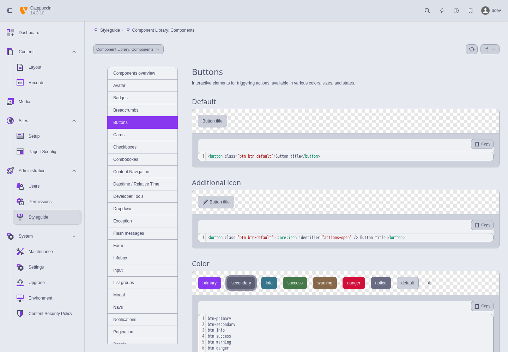
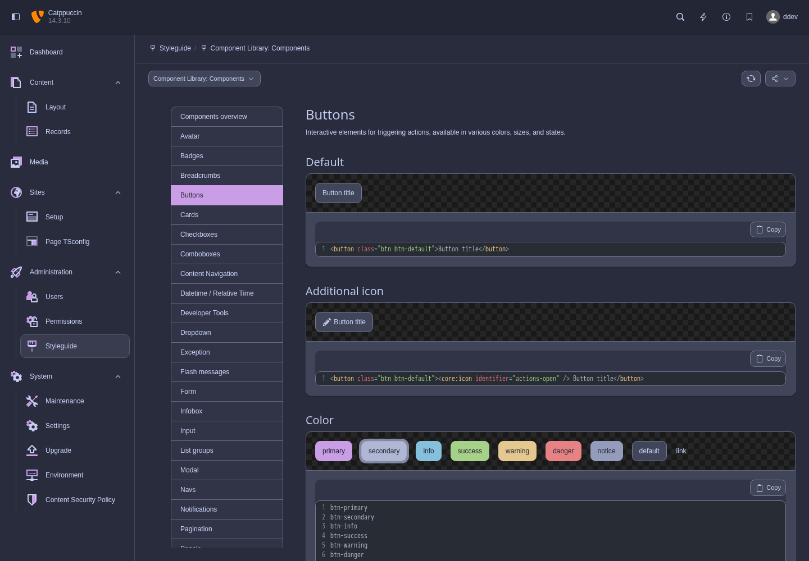
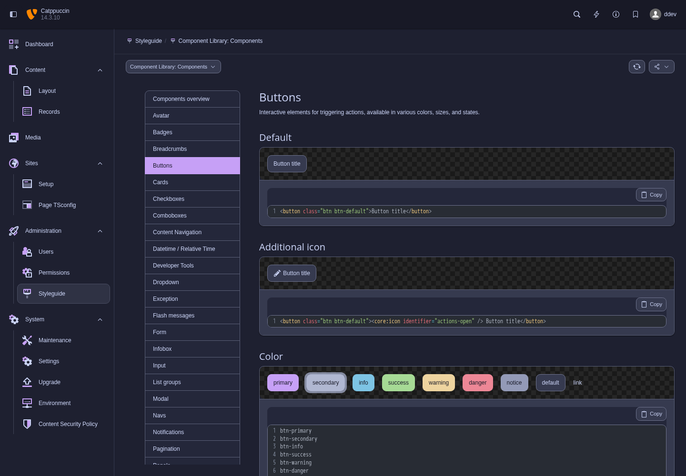
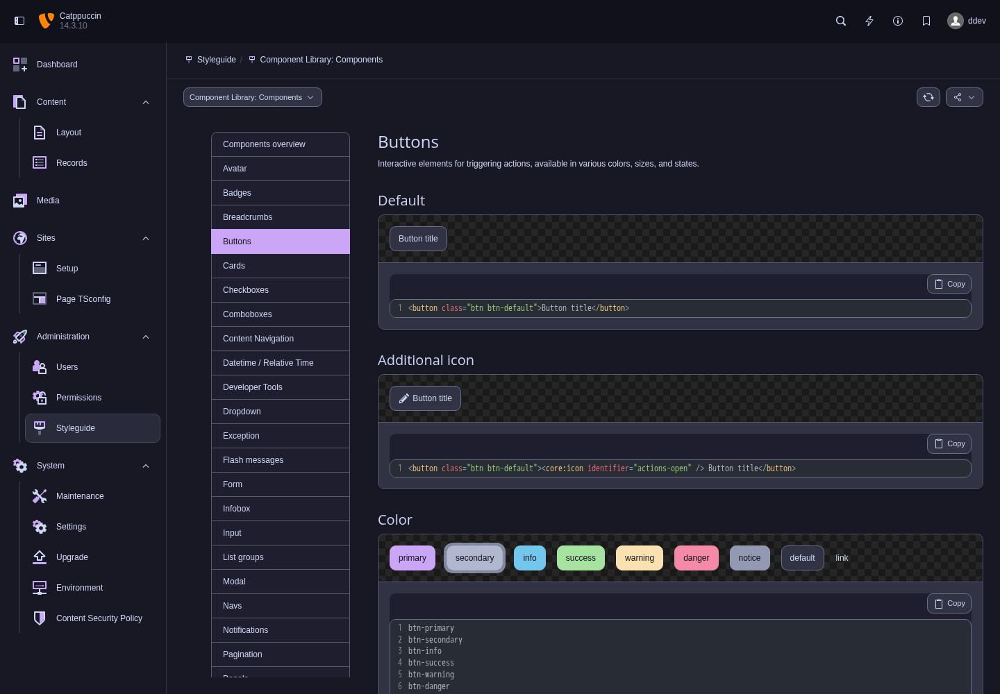
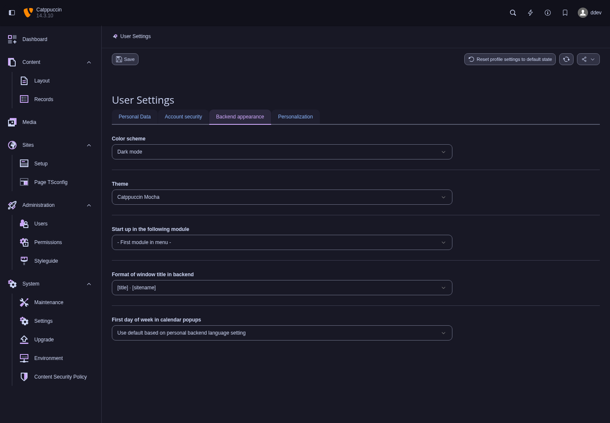

# Catppuccin for TYPO3

[](https://github.com/42lizard/typo3-catppuccin/actions/workflows/tests.yml)

The four [Catppuccin](https://catppuccin.com/) flavours in TYPO3's native backend theme selector: **Latte**, **Frappé**, **Macchiato** and **Mocha**.

Composer package: `42lizard/catppuccin` · Extension key: `catppuccin`

Requires **TYPO3 14.3 LTS** and **PHP 8.2+**. No runtime JavaScript, external fonts, CDN requests or frontend configuration. The compiled stylesheet is included in the package.

## Screenshots

Real TYPO3 14.3 backend screenshots, captured with the global Playwright MCP. The Styleguide module is a development dependency used to demonstrate the same components in each flavour.

| Latte | Frappé |
| --- | --- |
|  |  |
| **Macchiato** | **Mocha** |
|  |  |



## Installation

Install the package from [Packagist](https://packagist.org/packages/42lizard/catppuccin) in your TYPO3 project. No additional Composer repository configuration is needed.

```bash
composer require '42lizard/catppuccin:^0.1'
vendor/bin/typo3 cache:flush
```

The extension registers automatically. It requires no database migration or site set. The same commands work with `ddev composer` and `ddev typo3` in an existing DDEV project.

## Choose a flavour

Open your user menu → **User Settings → Backend appearance → Theme**, select a Catppuccin flavour and save. The selection is stored separately for each backend user. Fresh, Modern, Classic and other extensions' themes remain available.

Latte always uses a light colour scheme; Frappé, Macchiato and Mocha always use a dark colour scheme. This takes precedence over the separate Light/Dark/Auto setting while a Catppuccin theme is selected. Switch back to a Core theme to use that setting again.

The theme covers the backend shell and modules using TYPO3's design variables: surfaces, text, inputs, buttons, navigation and status messages. Some Latte accents are darkened for readable semantic text and solid buttons. Third-party modules with hardcoded colours and embedded editors may need their own styling.

TYPO3's backend CSS variables are currently an internal API. This extension targets the 14.3 LTS line; major TYPO3 upgrades require a compatibility review.

## Development with DDEV

The repository root is the extension. `Development/` contains a separate Composer project which installs the extension through a symlink. Changes to the extension are available immediately.

```bash
ddev start
ddev setup
ddev launch /typo3/
```

The setup command installs dependencies and creates the local admin **`ddev` / `ddev`**. Running it again restores these development credentials. The URL follows your DDEV configuration, including custom TLDs; use `ddev describe` to see it.

```bash
ddev test
node Build/build.mjs          # Regenerate the committed CSS after palette/token changes
node Build/build.mjs --check
```

The tests verify native theme registration, preservation of existing configuration, complete CSS variables, reproducible assets, and 4.5:1 contrast for semantic text on the base surface, search highlights, and solid state buttons including hover and focus. This is not a full accessibility audit of TYPO3 or third-party modules.

## License

The extension is licensed under **GPL-2.0-only** (GNU GPL version 2, without the “or later” option). See [LICENSE](LICENSE).

The bundled Catppuccin palette is © 2021 Catppuccin and remains under its [MIT license](Resources/Private/Palettes/LICENSE). The palette values are taken from [catppuccin/palette](https://github.com/catppuccin/palette).
